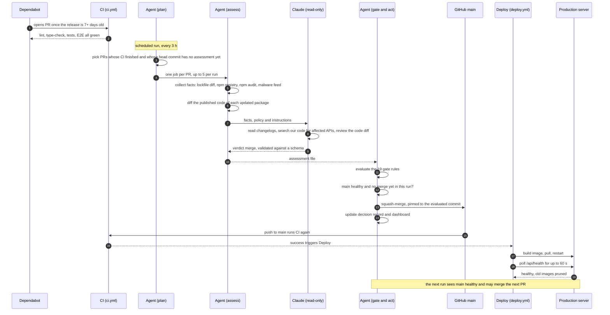
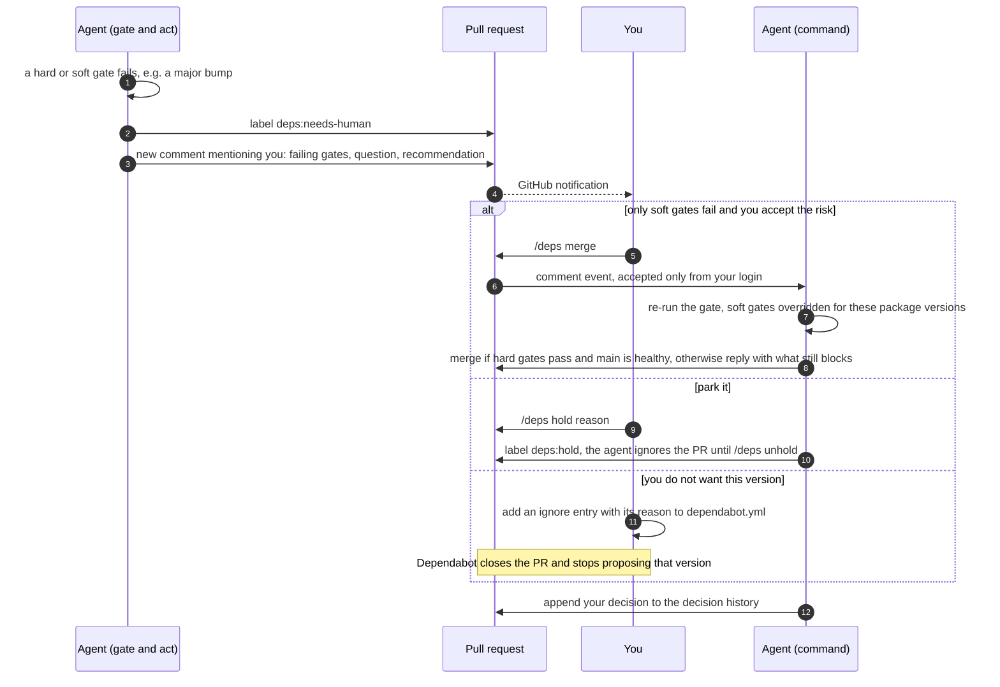
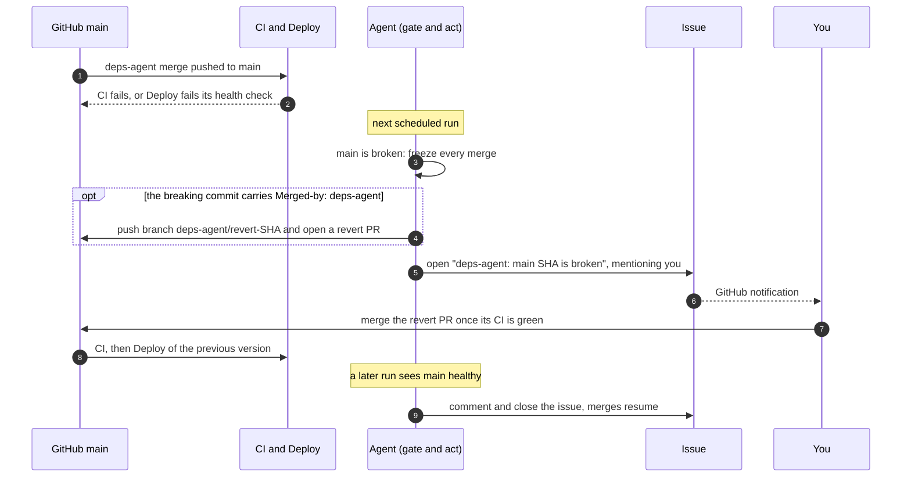
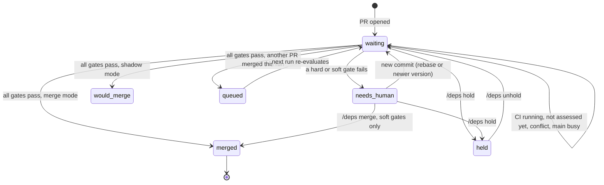

# Dependency updates: how deps-agent works

Gleanary keeps its npm dependencies current without a human in the loop for routine
bumps. Dependabot opens the pull requests; **deps-agent** (a scheduled GitHub Actions
workflow) checks each one and merges the safe ones. A merge to `main` deploys to
production, so the agent only merges when every gate passes, and it asks a human
about everything else.

| You want to know…             | Read                                                                         |
| ----------------------------- | ---------------------------------------------------------------------------- |
| How it works and what you do  | this page                                                                    |
| The exact merge rules (gates) | [`.github/deps-agent/policy.md`](../../.github/deps-agent/policy.md)         |
| Why it was built this way     | [ADR-010](../adrs/ADR-010-unattended-dependency-merges.md)                   |
| Versions we deliberately skip | `ignore` entries in [`.github/dependabot.yml`](../../.github/dependabot.yml) |
| The workflow itself           | [`.github/workflows/deps-agent.yml`](../../.github/workflows/deps-agent.yml) |

## In one minute

- Every **3 hours** the agent looks at open Dependabot PRs.
- For each PR whose CI has finished, **Claude reads the changelog against our code** and
  answers `merge` or `escalate`. Claude only has read access: it cannot merge, push or comment.
- A **deterministic gate** (plain code, no AI) then checks 19 rules: CI green, only
  `package.json`/lockfile changed, patch or minor version, release at least 7 days old,
  no malware advisory, nothing suspicious in the published code diff,
  npm provenance and publisher unchanged, no new install scripts or advisories, and more.
- If everything passes, the agent merges **at most one PR per run**, and only once the
  previous merge has passed CI on `main`, deployed, and answered the health check.
  Each production change therefore maps to a single dependency bump.
- If anything needs judgment, **you get a GitHub notification** with a question and a
  recommendation, and you answer with a `/deps` comment on the PR.
- If `main` breaks after one of its merges, the agent **stops merging**, opens a revert
  PR and pings you.

What you will see day to day:

| Where                          | What                                                             |
| ------------------------------ | ---------------------------------------------------------------- |
| Your GitHub notifications      | Only escalations and "main is broken" issues                     |
| **Dependency dashboard** issue | One row per open Dependabot PR and its current state             |
| Each Dependabot PR             | A **decision record** comment: gate results, assessment, history |
| `main` history                 | Squash merges with a `Merged-by: deps-agent` trailer             |
| Issues labeled `enhancement`   | New dependency features worth adopting (at most two per PR)      |

## How a PR travels

### 1. Happy path: a routine bump reaches production



### 2. Escalation: the agent needs your decision



Hard gates (wrong author, files outside the lockfile, red CI, suspected prompt
injection…) cannot be overridden: fix the cause or close the PR.

### 3. Broken main: a merge breaks CI or production



When CI fails on `main`, nothing was deployed and production is untouched. When the
health check fails, the new container is already running, so production stays degraded
until you merge the revert (or roll back by hand, see below).

### PR states

The decision record and the dashboard show one of these states:



## Your role

### Reading an escalation

The escalation comment lists the failing gates, then Claude's question, recommendation
and options. The decision record above it has the full gate table and history. Typical
cases:

| Failing gate               | Usually means                                            | Typical answer                                       |
| -------------------------- | -------------------------------------------------------- | ---------------------------------------------------- |
| `semver`                   | Major, or 0.x minor (no compatibility promise below 1.0) | Read the breaking changes Claude found, then decide  |
| `verdict`                  | Claude found a breaking change touching our code         | Fix it in a follow-up PR, or hold                    |
| `checks`                   | CI failed on the PR                                      | Read Claude's `ciRead`, fix or close                 |
| `cooldown`                 | Release younger than 7 days (often a security fix)       | `/deps merge` if the fix matters, otherwise wait     |
| `malware`                  | GitHub lists the new version as malware                  | Close the PR; check nothing installed it elsewhere   |
| `codeReview`               | Claude found suspicious code in the published diff       | Read the finding and the diff before anything else   |
| `publisher` / `provenance` | The package was published differently than last time     | Check the package's repo and npm page before merging |
| `installScripts`           | A dependency now runs code at install time               | Check what it runs; native modules are usually fine  |
| `injection`                | Changelog or PR text tried to instruct the agent         | Treat the release as suspicious; close or wait       |

### Commands

Comment on the Dependabot PR. Only the login in `DEPS_AGENT_OWNER` is obeyed.

| Command               | Effect                                                                                                       |
| --------------------- | ------------------------------------------------------------------------------------------------------------ |
| `/deps merge`         | Override the soft gates for these package versions (kept across rebases) and merge if everything else passes |
| `/deps hold <reason>` | Label `deps:hold`; the agent leaves the PR alone                                                             |
| `/deps unhold`        | Remove the hold                                                                                              |
| `/deps recheck`       | Run a fresh assessment of this PR now                                                                        |

Dependabot's own commands still work: `@dependabot rebase`, `@dependabot close`,
`@dependabot ignore this major version`.

### Decisions that outlive a PR

- **"Not this version"** (e.g. hold eslint 10 until typescript-eslint supports it): add
  an `ignore` entry to [`.github/dependabot.yml`](../../.github/dependabot.yml), with a
  comment giving the reason and when to revisit. Dependabot never opens a PR for it, so
  the agent never sees it, and git history records who decided and when. Delete the
  entry when the reason no longer holds.

  ```yaml
  ignore:
    # typescript-eslint does not support eslint 10 yet. Revisit when it does. (2026-10)
    - dependency-name: 'eslint'
      versions: ['>=10']
  ```

  Prefer this to `@dependabot ignore this major version`: that comment works, but the
  rule lives only on GitHub, with no reason attached.

- **Big decisions** (replacing a library, pinning a framework for months): write an ADR
  in [`docs/adrs/`](../adrs/).

- **"Always ask me before bumping package X"** is not supported yet. Majors, 0.x minors
  and breaking changes that touch our code already escalate. If a real case comes up,
  the plan is an `ALWAYS_ESCALATE` list in `gate.mjs`, checked by a soft gate.

## Runbooks

### Enable the agent

1. Create a GitHub App with repository permissions **Contents, Pull requests, Issues,
   Actions: read & write** and **Checks: read**, then install it on the repository.
   Merges need the App token: merges made with the default `GITHUB_TOKEN` do not
   trigger the CI run on `main` that Deploy waits for.
2. Repository secrets: `ANTHROPIC_API_KEY` (a dedicated key with a spend limit) and
   `DEPS_AGENT_APP_KEY` (the App's private key).
3. Repository variables: `DEPS_AGENT_APP_ID`, `DEPS_AGENT_APP_SLUG`,
   `DEPS_AGENT_OWNER` (your login), `DEPS_AGENT_MODE=shadow`, optionally
   `DEPS_AGENT_MODEL` (defaults to `claude-opus-5-5`).
4. Protect `main` with a ruleset requiring the four CI checks.
5. Run it once by hand: Actions → Deps agent → Run workflow.

### Switch from shadow to merge

In `shadow` mode the agent does everything except merge: PRs it would merge show
**would merge**. After one or two weeks, compare those rows with what you would have
done. When they agree, set `DEPS_AGENT_MODE=merge`.

### Stop everything

Set `DEPS_AGENT_MODE=off`: the next run does nothing. For an immediate stop, also
disable the workflow (Actions → Deps agent → ⋯ → Disable workflow). Open PRs and their
records stay as they are.

### Roll back a bad merge

- **CI or health check failed:** the agent opens a revert PR on its own. Merge it once
  its CI is green; Deploy ships the previous version.
- **Production misbehaves but every check is green** (a bug our tests miss): revert the
  squash commit through a normal PR, then add a `dependabot.yml` `ignore` entry for the
  bad version, with the reason.
- **Need production back before CI finishes:** on the server, a failed health check
  leaves the previous image in place (untagged). Find it with `docker images`, re-tag it
  `ghcr.io/gleanary/gleanary:latest`, then `docker compose up -d` in `/opt/gleanary`.

### Re-assess a PR

Comment `/deps recheck`, or run the workflow by hand with the `pr` input. Editing
`policy.md`, `prompt.md` or `assessment.schema.json` changes the policy fingerprint, so
every open PR is re-assessed over the next runs (up to five per run).

### When the agent itself fails

A PR whose assessment or evaluation errors stays **waiting**; the dashboard shows
`error` with the message, and the failed job is in the Actions tab. One PR's failure
never blocks the others.

## Reference

- **Gates and escalation rules:** [`policy.md`](../../.github/deps-agent/policy.md).
  The agent reads it at runtime, so it is the single source.
- **Code:** [`gate.mjs`](../../.github/deps-agent/gate.mjs) (rules, unit-tested in
  `__tests__/unit/deps-gate.test.ts`), [`cli.mjs`](../../.github/deps-agent/cli.mjs)
  (GitHub and npm I/O), [`record.mjs`](../../.github/deps-agent/record.mjs) (comments),
  [`prompt.md`](../../.github/deps-agent/prompt.md) and
  [`assessment.schema.json`](../../.github/deps-agent/assessment.schema.json) (Claude's
  instructions and output format).
- **Dependabot settings:** [`.github/dependabot.yml`](../../.github/dependabot.yml): weekly,
  7-day cooldown (none for security updates), dev patch/minor bumps grouped.
- **Hands-on triage:** the `/babysit-deps` Claude Code command uses the same policy.
- **Architecture context:** [`architecture.md` §9.5](../architecture.md#95-dependency-updates-deps-agent).
- **Cost:** one Claude assessment per set of package versions. A Dependabot rebase reuses
  it (every gate is still re-checked on the new commit); a newer version, a policy edit or
  a CI result turning red triggers a new one. Expect roughly $0.40–$1.50 per assessment
  on Claude Opus 5.5, and set a monthly spend limit on the dedicated API key.
